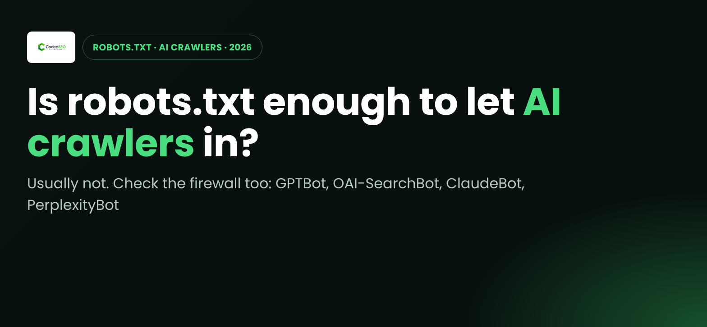
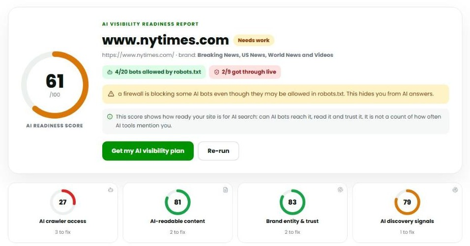
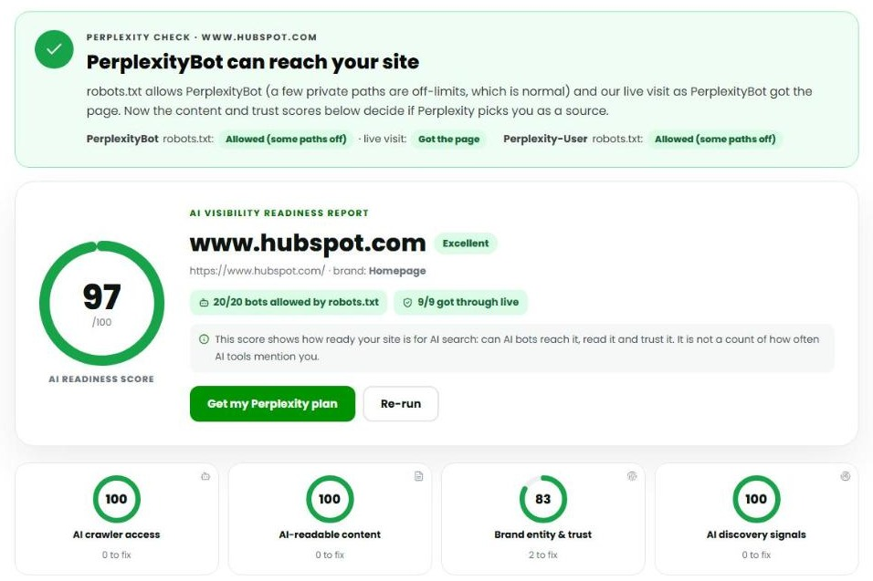

# AI crawlers and robots.txt (2026)

A plain list of the 20 AI crawlers that matter in 2026, what each one does, and copy-paste `robots.txt` templates for the three choices most websites make.

Maintained by [CodedSEO](https://codedseo.com). Want to check your own site? Our free [AI Visibility Checker](https://codedseo.com/tools/ai-visibility-checker) tests all 20 bots live, including firewall blocks that robots.txt can't show you.

## The 20 AI crawlers

| User agent | Company | Type | What it does |
|---|---|---|---|
| `GPTBot` | OpenAI | Training | Collects pages to train OpenAI models |
| `OAI-SearchBot` | OpenAI | AI search | Finds pages to show and cite in ChatGPT search |
| `ChatGPT-User` | OpenAI | User request | Fetches a page when a ChatGPT user asks for it |
| `ClaudeBot` | Anthropic | Training | Collects pages to train Claude models |
| `Claude-SearchBot` | Anthropic | AI search | Finds pages for Claude's search answers |
| `Claude-User` | Anthropic | User request | Fetches a page when a Claude user asks for it |
| `PerplexityBot` | Perplexity | AI search | Indexes pages for Perplexity answers |
| `Perplexity-User` | Perplexity | User request | Fetches a page when a Perplexity user asks for it |
| `Google-Extended` | Google | Training | Controls use of your pages for Gemini training (not a separate crawler) |
| `Googlebot` | Google | Search + AI Overviews | Normal Google crawling; AI Overviews and AI Mode use the same index |
| `Bingbot` | Microsoft | Search + Copilot | Bing index, used by Copilot and other AI search tools |
| `Applebot-Extended` | Apple | Training | Controls use of your pages for Apple Intelligence training |
| `Meta-ExternalAgent` | Meta | Training | Collects pages for Meta AI |
| `Amazonbot` | Amazon | AI search | Alexa and Rufus answers |
| `CCBot` | Common Crawl | Training | Open web dataset used by many AI models |
| `Bytespider` | ByteDance | Training | Collects pages for ByteDance models |
| `DuckAssistBot` | DuckDuckGo | AI search | DuckDuckGo AI answers |
| `MistralAI-User` | Mistral | User request | Fetches a page when a Le Chat user asks for it |
| `cohere-ai` | Cohere | Training | Collects pages for Cohere models |
| `YouBot` | You.com | AI search | You.com AI answers |

**Type, in plain words**
- **Training**: collects pages to train AI models. Blocking it does not remove you from AI answers.
- **AI search**: finds pages to show and cite in AI answers. Block it and you usually disappear from that tool's answers.
- **User request**: fetches one page because a person asked the AI about it.

## Three common robots.txt choices

| You want | Template |
|---|---|
| Show up everywhere, including AI answers | [`templates/allow-all.txt`](templates/allow-all.txt) |
| Show up in AI answers, but opt out of model training | [`templates/search-yes-training-no.txt`](templates/search-yes-training-no.txt) |
| Keep AI tools out completely | [`templates/block-all-ai.txt`](templates/block-all-ai.txt) |

Replace `https://example.com/sitemap.xml` with your own sitemap.

## robots.txt is not the whole story

Many sites allow AI bots in robots.txt but still block them at the firewall (Cloudflare "Block AI bots", host bot protection, WordPress security plugins). The bot then gets a 403 and you vanish from AI answers without knowing why.

When we tested two large sites on 16 Nov 2026 with the [AI Visibility Checker](https://codedseo.com/tools/ai-visibility-checker):
- **nytimes.com** allowed 4 of 20 AI bots in robots.txt, and only 2 of 9 live test visits got through.
- **hubspot.com** allowed all 20, and all 9 live visits got through.

## How to check your site

1. Open `yoursite.com/robots.txt` and look for the user agents above.
2. Check your firewall or CDN for an "AI bots" or "bot fight" setting.
3. Run a live test: [AI Visibility Checker](https://codedseo.com/tools/ai-visibility-checker) (free, no sign-up).

More data on how people use AI search: [AI Search Statistics 2026](https://codedseo.com/ai-search-statistics).

## Sources

Each company's own crawler documentation: OpenAI, Anthropic, Perplexity, Google, Microsoft, Apple, Meta, Amazon, Common Crawl. User agent names change; open an issue if one here is out of date.

## License

MIT. Use the list and templates freely.
